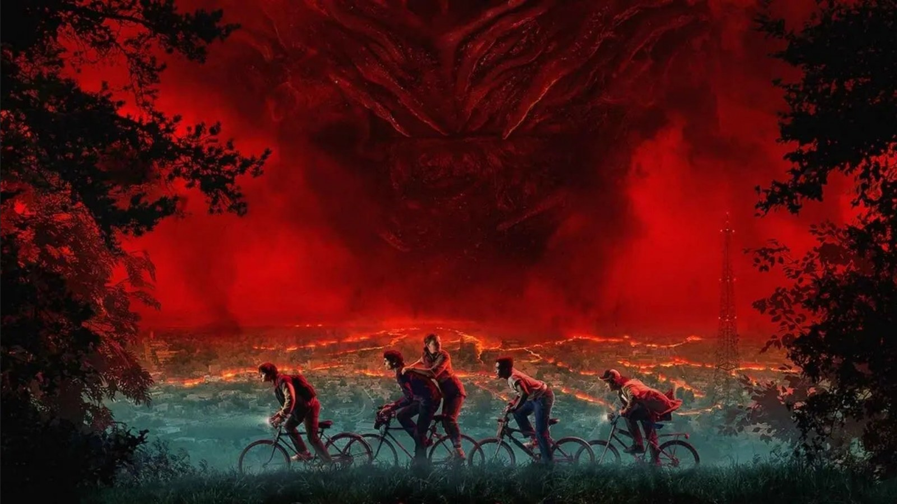

# Stranger Things



> "Friends don't lie." — Eleven, season one

**At a glance:** a sci-fi horror series set in the small town of Hawkins, Indiana. Four seasons so far, 34 episodes[^1], one alternate dimension, and a group of kids who keep riding their bikes into trouble.

## What it is

*Stranger Things* starts in 1983 with a missing boy and a girl who escapes from a laboratory. What looks like a monster-of-the-week show turns into a story about grief, growing up, and the fact that adults rarely believe children. The horror is real, but the show works because the friendships are written properly.

I first watched it in 2022, during the break between the fourth season's two volumes, and ended up watching the whole thing again within a month. The second time around, the small details stood out more: the walkie-talkie calls, the Christmas lights, the way every season opens with the same shot of the same town.

## The seasons, ranked

| Rank | Season | Year | Episodes | Main villain | Short verdict |
| :--: | :--- | :--: | :--: | :--- | :--- |
| 1 | Season 4 | 2022 | 9 | Vecna | The scariest and the most emotional of the four. |
| 2 | Season 1 | 2016 | 8 | Demogorgon | Still the tightest story. Nothing is wasted. |
| 3 | Season 3 | 2019 | 8 | The Mind Flayer | The mall setting is a lot of fun. |
| 4 | Season 2 | 2017 | 9 | The Mind Flayer | The one episode away from Hawkins is the weak spot. |

My least favourite episode is "The Lost Sister", the one where Eleven goes to Chicago. It stops the season dead, and the story never really needs it.

## The party

- **Eleven (Jane Hopper)** — telekinetic, raised in Hawkins Lab, still learning how to be a normal teenager.
  - First seen: season 1, episode 1
  - Favourite scene: closing the gate at the end of season 2
- **Mike Wheeler** — the one who never stops believing his friends, even when he is being annoying about it.
  - First seen: season 1, episode 1
  - Favourite scene: the "I love you" speech in season 3
- **Dustin Henderson** — comic relief who is also the smartest person in the room.
  - First seen: season 1, episode 1
  - Favourite scene: the NeverEnding Story singalong
- **Lucas Sinclair** — the sceptic, which the group badly needs.
  - First seen: season 1, episode 1
  - Favourite scene: the slingshot in the junkyard
- **Max Mayfield** — skateboarder, sceptic number two, and the centre of season 4.
  - First seen: season 2, episode 1
  - Favourite scene: "Dear Billy"
- **Steve Harrington** — started as the bully, ended up as the best babysitter on television.
  - First seen: season 1, episode 1
  - Favourite scene: the bat fight in season 2

## Hawkins, in one diagram

```text
            +------------ HAWKINS, INDIANA ------------+
            |  Wheeler house        Hawkins Lab        |
            |  Byers house          Hawkins Middle     |
            |  Palace Arcade        Starcourt Mall     |
            |  Cemetery             Forest / quarry    |
            +---------------------+---------------------+
                                  |
                                  |  gate
                                  v
                        +-------------------+
                        |   THE UPSIDE DOWN |
                        |  vines, spores,   |
                        |  and Vecna        |
                        +-------------------+
```

## Rules of the Upside Down

1. The gate stays open only while something keeps it open.
2. Creatures share one mind, so hurting one warns the rest.
3. The air is toxic to humans within minutes.
4. Time and space run differently, which is why radios pick up the past.
5. A memory of someone you love is the strongest thing you can carry in.

## Rewatch checklist

- [x] Season 1
- [x] Season 2
- [x] Season 3
- [x] Season 4, volume 1
- [x] Season 4, volume 2
- [ ] Watch *Beyond Stranger Things* and the behind-the-scenes specials
- [ ] Read the *Stranger Things* comic prequels
- [ ] Rewatch season 4 before season 5 arrives

## Things people get wrong

- ~~The show is about the monster.~~ It is about a town that keeps losing people and a group of kids who refuse to accept it.
- ~~Season 2 is filler.~~ It sets up the Mind Flayer, which drives the next two seasons.
- ~~Eleven is the main character.~~ Every season gives the plot to a different member of the party.

## Spoiler drawer

<details>
<summary><strong>Click to reveal: what actually happened to Will in season 1</strong></summary>

Will was taken into the Upside Down and survived there for a week by hiding from the Demogorgon. When he is found, the creature is still linked to him, which is why he keeps coughing up slugs and sensing the Mind Flayer later.

</details>

<details>
<summary><strong>Click to reveal: the season 4 twist</strong></summary>

Vecna, the monster of season 4, is Henry Creel, the boy who killed his family in the 1950s and was experimented on by Dr. Brenner. Everything in the season, including the Creel house and the gates, traces back to him.

</details>

## Soundtrack picks

1. "Running Up That Hill" by Kate Bush, which brought the song back to the charts 37 years after release.
2. "Master of Puppets" by Metallica, used for the best scene in season 4.
3. "Should I Stay or Should I Go" by The Clash, the song that connects Will and Jonathan.

## Where to watch

| Platform | Available | Note |
| :--- | :---: | :--- |
| Netflix | ✅ | All four seasons |
| Local DVD | ❌ | No official release in the Philippines |
| Rental | ❌ | Not available on other services |

## About this repository

This `README.md` was written for **CITE1008, Application Development**, Pre-Final Performance Task. The task was to write about a favourite series using different Markdown elements, so this page uses headings, tables, lists, a nested list, a task list, a fenced code block, blockquotes, strikethrough, a collapsible `<details>` section, an image, links, and a footnote.

**Author:** Jellah Mae Talavero
**Section:** BSIT 3E
**Date:** November 2026

[^1]: Season 5 had not been released when this was written, so the episode count covers seasons 1 to 4.
